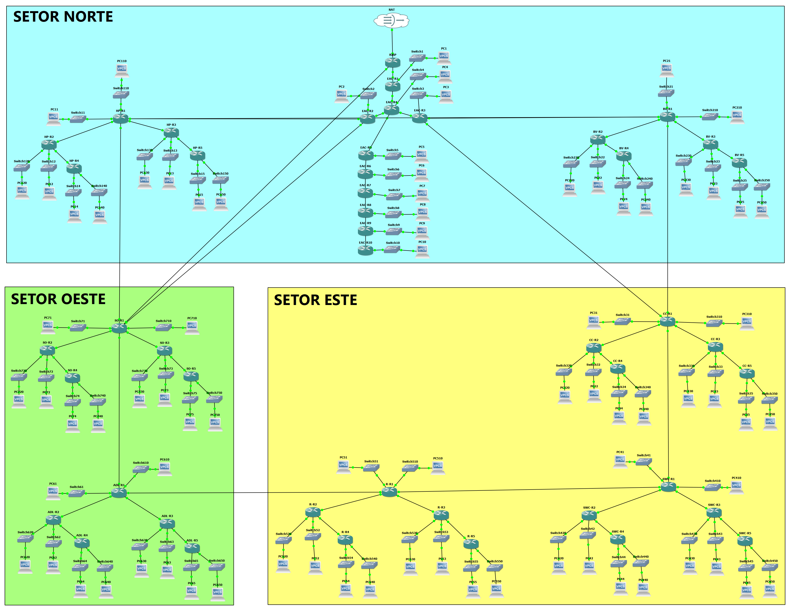

# Atlantic Bay Resort & Spa: Enterprise Network in GNS3

Planning, simulation and configuration of the local and wide-area network of a fictional resort complex, built from scratch in GNS3 with Cisco IOU routers.

> Individual project for the *Data Routing* course, Computer Engineering, ISEC, 2025/26. The report in `docs/` is written in Portuguese.

## Overview

The resort has a Central Administrative Building (**EAC**, 10 routers) and 7 units, each with at least 5 routers and at least 10 subnets:

| Code | Unit |
|---|---|
| HP | Main Hotel |
| BV | Bungalows & Villas |
| CC | Conference Center |
| SWC | Spa & Wellness Center |
| R | Restaurants |
| ADL | Sports & Leisure Area |
| SO | Operational Services |

The complex is split into three geographic sectors (north, east, west), with the EAC, the Conference Center and Operational Services in different sectors. Units connect to each other and to the EAC over 100 Mbps links. Every subnet has at least one end host.



## What is implemented

| Area | Implementation |
|---|---|
| **IPv4 addressing** | VLSM from `194.65.80.0/20`; private `/30` links (`172.16.0.0/16`) between routers to save public space; LANs sized to need (e.g. `/25`, `/27`, `/28`) |
| **OSPF (EAC)** | Multi-area OSPF with a virtual link from `EAC-R4` to router `1.1.1.7` (`EAC-R7`) across Area 1, with message-digest authentication |
| **Protocol diversity** | No two units in the same sector run the same IPv4 routing protocol (e.g. in the north: OSPF at the EAC, RIPv2 at HP, EIGRP at BV), with redistribution at the borders for full reachability |
| **EIGRP filtering** | In Operational Services, prefix-list `BLOQUEIO` on `SO-R2` denies `194.65.80.128/25` and permits everything else |
| **Route summarization** | `SWC-R1` summarizes the Spa's 10 subnets into `194.65.88.0/24`, seen at `SO-R2` as an EIGRP external route |
| **Policy-Based Routing** | In the Spa unit, ACL `105` matches a Spa LAN and route-map `PBR_SPA` forces the next hop `172.16.0.69` |
| **IPv6** | Conference Center addressed with `2001:DB8:CC::/64`, connected to the IPv4 core through an IPv6-over-IPv4 tunnel as the transition strategy |
| **Internet access** | Primary 1 Gbps link at the EAC (`10.20.85.248/30`) and a secondary 100 Mbps link from Operational Services (`10.30.85.148/30`) |
| **Failover** | Floating static default route on `SO-R1` (`ip route 0.0.0.0 0.0.0.0 10.30.85.149 200`), only used when the primary path is unavailable |
| **Device hardening** | Single Telnet session (`line vty 0`), `service password-encryption`, MOTD banner with the device name |
| **ISP simulation** | ISP side reachable at `2.2.2.2` for end-to-end tests |

## Opening the project

Requirements: GNS3 2.2.54 or later and the Cisco IOU router image `i86bi-linux-l3-adventerprisek9-15.4.1T.bin`.

1. In GNS3: *File → Import portable project* and select `gns3/atlantic-bay.gns3project`.
2. Assign your IOU image to the router template if GNS3 asks for it.
3. The topology has at least 45 routers, so start the nodes in batches (sector by sector) and give the protocols time to converge before testing.
4. Router configurations are also available as plain text in `configs/`.

## Repository structure

```
├── docs/        Report and assignment (Portuguese)
└── gns3/        Portable GNS3 project (no IOU images) and topology diagram
```

## Author

Artur Falcão
